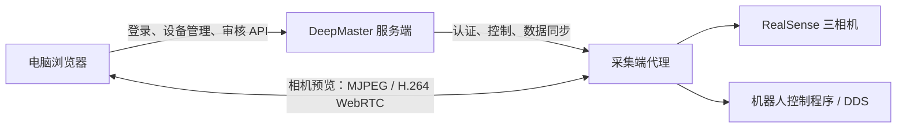

<p align="center">
  
</p>

# DeepMaster

足臂机器人数据采集与审核平台。DeepMaster 将网页服务、采集端设备代理和浏览器操作界面分开部署，用于设备管理、三相机预览、遥操作采集、数据清洗、审核和数据集导出。

当前版本：`v3.3.2-beta`

## 功能

- **设备管理**：管理在线采集端、设备配置和配对状态。服务端与采集端版本必须一致才能配对。
- **近控采集**：沿用现有采集流程，在本地网络下预览相机并录制数据。
- **远控采集**：浏览器查看三路相机画面并进行远程操作；预览媒体直接从采集端发送到浏览器，服务端负责登录保护、信令和任务协调。
- **远控仅控制**：只启动遥操作和相机预览，不创建录制任务。三路 H.264 视频通过 WebRTC 从采集端直达浏览器；默认以最低码率和 640×360 下限启动，所有图传阶段稳定且呈现达到源帧率 90% 后逐档提升画质，拥塞时降档。
- **数据审核**：按 episode 查看三路相机画面、帧时间轴和机器人状态曲线；支持任务分段、单条及批量审核。
- **数据入库清洗**：上传入库时去除相机首帧黑屏和冻结帧，并对相关数据序列使用相同的保留帧索引，保持时间戳对齐。
- **LeRobot 导出**：从审核结果中导出标记为合格的数据，原始采集端文件不会因此被删除。

## 架构



服务端保存数据集副本、账号和审核状态。采集端负责相机读取、机器人程序协调和录制文件管理。浏览器访问服务端完成管理与审核；实时预览媒体由采集端直接发送给浏览器，不经过服务端转发。远控工作时，浏览器、服务端和采集端需要通过可互访的内网或 VPN 连接。连接失败时，页面会显示 ICE/DTLS 状态、候选网络路径及三路视频解码状态，便于区分信令、网络和相机问题。

## 代码结构

| 路径 | 内容 |
| --- | --- |
| `assets/`、`index.html` | 网页界面、设备操作和审核交互 |
| `server/api.py`、`server/auth.py`、`server/db.py` | 服务端 API、身份验证和 SQLite 数据库 |
| `server/agent.py`、`server/runner.py`、`server/cam.py` | 采集端代理、机器人进程管理和相机接口 |
| `orin/` | 采集端相机预览及 WebRTC 媒体处理 |
| `packaging/`、`make-packages.sh` | 部署包构建脚本、安装脚本和简要部署说明 |
| `tests/` | Python 与 JavaScript 自动化测试 |

## 环境要求

- **服务端**：Ubuntu、Python 3、systemd。用于网页静态资源、登录 API、设备管理、数据集和审核记录。
- **采集端**：Ubuntu aarch64 设备、ROS 2 Humble、RealSense 驱动及相机。机器人程序和运行库由部署环境提供，不包含在 GitHub Release 的源代码压缩包内。
- **远控预览**：浏览器使用近期版本的 Chrome 或 Edge；采集端需具备对应的硬件视频编码及 GStreamer WebRTC 运行依赖。网络需允许浏览器与采集端互通。远控仅控制使用采集端预览端口的 UDP 地址发现（默认 UDP 5000），以及 WebRTC 协商出的 UDP 媒体端口，无需公网 STUN 服务。

服务端和采集端应部署同一个版本。设备首次接线后，在网页的设备信息页填写该设备专属的 DDS 主机和机器人工作目录等配置；采集端包内已有的程序路径由部署包管理，无需在网页重复填写。

首次部署时请设置强管理员密码。远控设备应放在可信内网或 VPN 中，并限制服务端及采集端管理接口的网络访问范围。

## 构建与部署

GitHub Release 提供源代码压缩包，不附带预编译的服务端包或采集端包。服务端部署包可从源码构建：

```bash
tar -xf deepmaster-3.3.2-beta.tar.gz
cd deepmaster
./make-packages.sh server
```

采集端包需要部署环境提供机器人程序和运行库。将其目录提供给构建脚本：

```bash
DM_PROGRAM_SOURCE=/path/to/orin-progs ./make-packages.sh orin
```

脚本检查所需程序、运行库及 ARM64 运行时后生成 `dist/orin-collect-v3.3.2-beta-*.tar.gz`。服务端生成 `dist/server-review-v3.3.2-beta-*.tar.gz`。构建成功后，分别按照 [`packaging/README-server.md`](packaging/README-server.md) 和 [`packaging/README-orin.md`](packaging/README-orin.md) 安装；服务端网页默认端口为 `8790`，API 默认端口为 `8765`，采集端代理端口由设备发现与配置确定。

## 测试

在仓库根目录运行单元测试：

```bash
python3 -m unittest discover -s tests -p 'test_*.py'
for test_file in tests/test_*.js; do node "$test_file" || exit 1; done
```

`tests/run-all.sh` 是针对运行中服务端的界面验收脚本；其中部分套件会创建或删除测试账号、写入测试记录，不应直接对生产环境运行。

## 版本

版本号记录在 [`VERSION`](VERSION)，功能与修复记录在 [`CHANGELOG.md`](CHANGELOG.md)。采集端和服务端应使用同一 Release 版本。

## 许可

本项目采用 [MIT License](LICENSE)。

## 界面截图

<details>
<summary>查看截图</summary>


</details>

Copyright (c) 2026 deeprobotics

Author: Chenyu Guo

Date: November 2026
